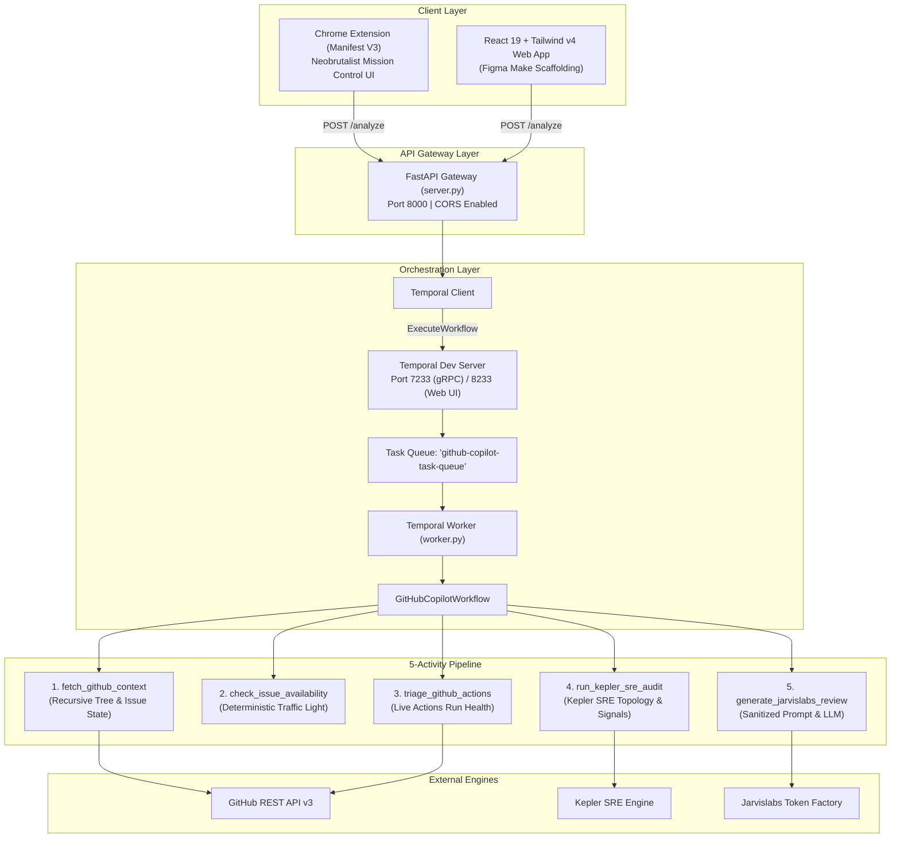

# 🚀 First PR & Repo Copilot

> **AI-Powered Chrome Extension & SRE Copilot for GitHub Contributors, DevOps Engineers, and Maintainers.**  
> Built with **Temporal**, **Jarvislabs Token Factory**, and **Kepler SRE IDE by RubixKube**, integrated with **`github-actions-ai-agent`**.

[](LICENSE)
[](https://www.python.org/)
[](https://fastapi.tiangolo.com)
[](https://temporal.io)
[](https://jarvislabs.net)
[](https://rubixkube.com)
[](https://developer.chrome.com/docs/extensions/mv3/)

---

## 📌 Executive Summary & Problem Solved

Hacktoberfest and open-source programs bring thousands of eager first-time contributors to GitHub, but the majority abandon their efforts before opening their first Pull Request:
1. **Ghost & Claimed Issues:** Contributors waste days writing code for issues that were already claimed inside obscure comment threads.
2. **Context Overload:** Repositories have hundreds of files; newcomers have no idea which 2–3 files actually need editing.
3. **Silent CI Regressions:** When tests on `main` fail due to upstream regressions, beginners assume their local setup is broken.

**First PR & Repo Copilot** provides an in-browser mission control that reviews any GitHub repository or issue in seconds:
- 🟢 **Deterministic Traffic Light Engine:** Plain-code rules check whether an issue is truly open (`GREEN`), claimed in comments (`AMBER`), or assigned/closed (`RED`).
- 🛡️ **Kepler SRE IDE by RubixKube:** Audits operational topology (`Dockerfile`, CI/CD, Helm/K8s, tests, lockfiles), calculates blast radius, and computes an **SRE Readiness Score (0–100)**.
- ⚡ **Dynamic CI/CD Triage (`github-actions-ai-agent`):** Queries live GitHub Actions runs, pinpoints broken steps (e.g. `npm test`), and masks secrets with prompt trust boundaries.
- 🧠 **Jarvislabs Token Factory LLM:** Pinpoints exact files to edit, extracts setup commands, formulates an action plan, and drafts a polite *"Can I be assigned?"* comment.
- 🔄 **Temporal Durable Execution:** A 5-activity workflow that survives mid-scan worker crashes and network interruptions.

---

## 🏆 The 3 Mandatory Sponsor Integrations

### 1. 🔄 Temporal (Durable Orchestration Layer)
* **What it does:** Orchestrates the entire multi-step analysis pipeline as independent, retryable Temporal Activities.
* **Why it matters:** Unlike standard API gateways that drop in-flight requests during server restarts or timeouts, Temporal logs activity inputs and return values in an immutable event history.
* **The Live Worker Crash Demo:** During judging, we trigger a scan, kill `worker.py` (`Ctrl+C`) mid-flight, show `http://localhost:8233` holding state after GitHub fetching, and restart `worker.py` to resume execution without re-fetching GitHub data or wasting rate limits!

### 2. 🧠 Jarvislabs Token Factory (Core Intelligence Layer)
* **What it does:** Hosts open-model LLMs (`DeepSeek V4.1 Flash`, `GLM-5.3 Flash`, `Qwen 3.8 27B FP8`, `Gemma 4 31B IT`) via an OpenAI-compatible Chat Completions API (`https://models.jarvislabs.net/v1`).
* **Why it matters:** Ingests repository file structures, README context, Traffic Light availability signals, and Kepler SRE audit results to synthesize a strictly structured JSON review with zero hallucination.

### 3. 🛡️ Kepler SRE IDE by RubixKube (Operational Readiness Layer)
* **CRITICAL DISTINCTION:** This is **Kepler by RubixKube** (the desktop AI SRE IDE / Rubix CLI for operational readiness and blast-radius analysis), **NOT** the unrelated CNCF container power-monitoring tool.
* **What it does:** Operates as an automated SRE subagent (`run_kepler_sre_audit`) inspecting repository infrastructure manifests (`Dockerfile`, `.github/workflows/`, Helm charts, Kubernetes manifests, lockfiles) to identify deployment gaps and compute the `sre_readiness_score`.

---

## ⚡ Shubham Londhe's `github-actions-ai-agent` Integration

We augmented our pipeline with production patterns from [LondheShubham153/github-actions-ai-agent](https://github.com/LondheShubham153/github-actions-ai-agent):
- **Live Actions Run Triage (`triage_github_actions`):** Directly queries `/actions/runs` to detect if `main` branch CI is currently broken, isolating the failed job and step.
- **Enterprise Security & Redaction (`safety.py`):** Automatically scrubs GitHub tokens (`ghp_`), AWS keys, and secrets from issues, comments, and READMEs before LLM ingestion.
- **Untrusted Prompt Boundaries:** Wraps external repository content in `<untrusted_github_context>` tags to defend against prompt injection attacks.

---

## 🏗️ System Architecture



---

## 🎨 Chrome Extension (Manifest V3)

The extension features a Figma-designed **Neobrutalist "OSS MISSION CONTROL"** theme:
- ☾ / ☀ **Cyberpunk Light/Dark Mode Toggle**
- 🚦 **Striped Traffic Light Availability Banner** (`[STATUS: OPEN TO TAKE]`)
- 📊 **3-Score Card Grid** (`STRUCTURE`, `BEGINNER_FRIENDLY`, `KEPLER_SRE`)
- 📂 **Target Files Module** (pinpointing exactly which files to edit)
- 💻 **Shell Terminal Box** (copyable setup commands with simulated test metrics)
- 📋 **Numbered Action Plan** (~20 min estimated resolution time)
- 🛡️ **Kepler SRE Audit Signals** (`[✓ DOCKER]`, `[✓ CI/CD]`, `[✗ K8S]`)
- 💬 **Ready-to-Post Issue Comment** with one-click copy (`⌘C`)

---

## 📁 Repository Structure

```text
mauji/
├── README.md               # Complete documentation & pitch guide
├── context.md              # Team & AI assistant single source of truth
├── requirements.txt        # Backend dependencies
├── .gitignore              # Git ignore rules
├── .env                    # Local secrets (API keys) - Git-ignored
│
├── backend/
│   ├── server.py           # FastAPI REST API (Sync /analyze, Quick Check, Async Workflow)
│   └── worker.py           # Temporal Workflow + 5 Activities (GitHub, Kepler, Jarvislabs)
│
├── extension/              # Chrome Extension (Manifest V3)
│   ├── manifest.json       # Extension configuration (activeTab, permissions)
│   ├── popup.html          # Neobrutalist Mission Control UI
│   └── popup.js            # Auto tab URL detection & backend integration
│
└── frontend/               # React 19 + Tailwind CSS v4 + Vite Web App
    ├── package.json
    ├── vite.config.ts
    ├── index.html
    └── src/
        ├── App.tsx         # Figma Make interactive dashboard
        ├── index.css       # JetBrains Mono + Space Grotesk styling
        └── main.tsx
```

---

## 🚦 Quickstart Setup Guide

### 1. Prerequisites
- Python 3.10+
- Google Chrome browser
- [Temporal CLI](https://docs.temporal.io/cli) installed

### 2. Environment Variables
Create a `.env` file in the project root:
```bash
# Optional GitHub Token (prevents rate limits on recursive tree queries)
GITHUB_TOKEN="ghp_xxx"

# Jarvislabs Token Factory API Key
JARVISLABS_API_KEY="jl_xxx"
JARVISLABS_MODEL="deepseek-ai/DeepSeek-V4.1-Flash"

# Google AI Studio / Gemma Key (optional fallback)
GEMMA_API_KEY="AQ.xxx"
```

### 3. Install Python Dependencies
```bash
pip install -r requirements.txt
```

### 4. Start the Temporal Server
```bash
temporal server start-dev
```
*Open Web UI at: [http://localhost:8233](http://localhost:8233)*

### 5. Start the Temporal Worker
In Terminal 1:
```bash
python backend/worker.py
```

### 6. Start the FastAPI Gateway
In Terminal 2:
```bash
python -m uvicorn backend.server:app --host 127.0.0.1 --port 8000 --reload
```
*Health Check: [http://127.0.0.1:8000/health](http://127.0.0.1:8000/health)*

### 7. Install Chrome Extension
1. Open Google Chrome and navigate to `chrome://extensions/`.
2. Enable **Developer mode** (top-right toggle).
3. Click **Load unpacked** and select the [`extension/`](./extension) directory.
4. Open any GitHub repository or issue, click the extension icon, and hit **SCAN REPO ↗**!

---

## 📡 Backend API Contract

### Synchronous Scan: `POST http://127.0.0.1:8000/analyze`
```json
{
  "github_url": "https://github.com/owner/repo/issues/42",
  "use_case": "first_pr"
}
```

### Response (`200 OK`):
```json
{
  "repo": "owner/repo",
  "total_files_scanned": 142,
  "availability": {
    "status": "GREEN",
    "badge": "OPEN TO TAKE",
    "reason": "Unassigned, open, and no claiming comments detected!"
  },
  "kepler_audit": {
    "sre_readiness_score": 85,
    "engine": "Kepler SRE Subagent Active (Static Repo Topology + Dynamic CI Health)",
    "signals": {
      "containerized": true,
      "ci_cd_pipelines": true,
      "k8s_manifests": false,
      "test_suite_present": true,
      "dependency_manifest": true,
      "ci_runs_passing": true
    }
  },
  "review": {
    "overall_repo_score": 84,
    "score_breakdown": {
      "structure_score": 88,
      "beginner_friendliness": 80,
      "sre_infra_score": 85
    },
    "two_sentence_summary": "Plain-English explanation of what this issue requires.",
    "files_to_inspect": [
      {
        "path": "src/api/routes.py",
        "why": "Contains the endpoint handler mentioned in the issue description."
      }
    ],
    "setup_commands": [
      "git clone https://github.com/owner/repo.git",
      "pip install -r requirements.txt"
    ],
    "personalized_action_plan": [
      "Fork the repository and create a branch named fix/issue-42.",
      "Update src/api/routes.py to handle empty query parameters.",
      "Run pytest to verify no regressions."
    ],
    "kepler_sre_insight": "CI workflows and Dockerfile are present; recent Actions run succeeded on main branch.",
    "ready_to_post_comment": "Hi! I noticed this issue is unassigned. I've reviewed src/api/routes.py and would love to submit a PR for this—could you please assign it to me?"
  }
}
```

---

## 🎭 Reviewer Personas

- **First-Time Contributor (`first_pr`):** Prioritizes beginner accessibility, picks the exact 2–4 files to touch, extracts setup commands, and drafts a polite assignment request comment.
- **SRE / DevOps Audit (`sre_ops`):** Evaluates `Dockerfile` hygiene, CI/CD pipeline coverage, Kubernetes/Helm manifests, lockfiles, and blast radius.
- **Maintainer / Auditor (`maintainer_audit`):** Focuses on directory modularity, onboarding friction, documentation gaps, and test coverage.

---

## 🏆 The 60-Second Winning Pitch Script

> *"Hacktoberfest brings thousands of first-time contributors to GitHub, but most give up before their first pull request. Issues are written for insiders, and half the 'good first issues' are already quietly claimed in the comments.*
>
> *We built **First PR & Repo Copilot**—a Chrome Extension powered by **Temporal**, **Jarvislabs Token Factory**, and **Kepler SRE IDE by RubixKube**.*
>
> *Open any GitHub repo or issue, pick your persona—First-Time Contributor, SRE, or Maintainer—and click Scan. First, plain-code rules run a **Traffic Light check** to tell you in one second if the issue is truly open or already claimed. Second, our **Kepler SRE layer and Actions triage** audit the file tree and recent CI runs for operational readiness and broken tests. Third, **Jarvislabs Token Factory** scores the codebase out of 100, pinpoints the exact files to edit, and writes a beginner-friendly PR plan and assignment comment.*
>
> *Best of all, every step runs as a **Temporal workflow**—if I kill our worker process mid-scan right now `[Ctrl+C on worker]`, Temporal preserves the GitHub and Kepler state and resumes automatically the second the worker restarts `[restart worker]`!"*

---

## 👥 Contributors & Acknowledgements
- Developed for Hackathon & Open Source Mission Control.
- Special thanks to **Jarvislabs**, **Temporal**, and **RubixKube (Kepler SRE IDE)** for sponsor APIs and architecture patterns.
