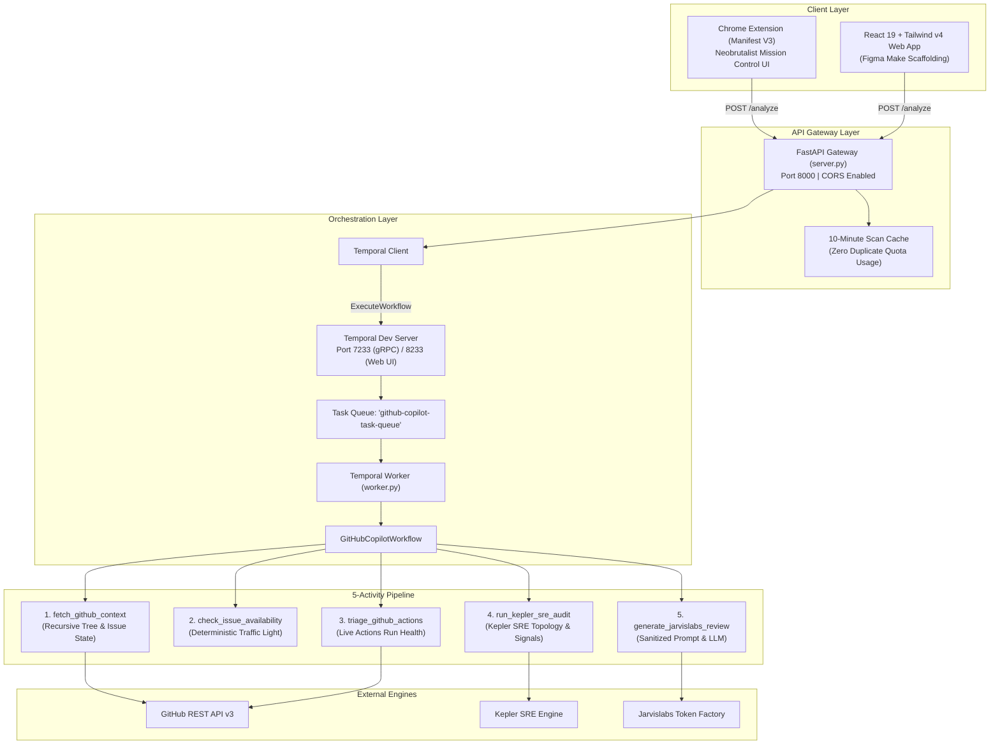

# 🚀 First PR & Repo Copilot

> **AI-Powered Chrome Extension & Autonomous SRE Copilot for GitHub Contributors, DevOps Engineers, and Maintainers.**  
> Built with **Temporal**, **Jarvislabs Token Factory**, and **Kepler SRE IDE by RubixKube**, integrated with **`github-actions-ai-agent`**.

[](LICENSE)
[](https://www.python.org/)
[](https://fastapi.tiangolo.com)
[](https://temporal.io)
[](https://jarvislabs.net)
[](https://rubixkube.com)
[](https://developer.chrome.com/docs/extensions/mv3/)

---

## 📌 Executive Summary

Every year, Hacktoberfest and open-source initiatives attract thousands of aspiring developers, yet over **70% of first-time contributors drop out** before opening their first pull request. 

### The 3 Core Friction Points
1. **Ghost & Claimed Issues:** Contributors spend hours or days solving an issue, only to discover it was already claimed in deep comment threads.
2. **Context Overload:** Complex codebases contain hundreds of files with no clear starting point for newcomers.
3. **Silent CI Regressions:** When tests on `main` fail due to upstream regressions, beginners assume their local environment is broken and give up.

**First PR & Repo Copilot** provides an in-browser mission control that reviews any GitHub repository or issue in seconds:
- 🟢 **Deterministic Traffic Light Engine:** High-speed plain-code rules detect if an issue is truly open (`GREEN`), claimed in comments (`AMBER`), or assigned/closed (`RED`).
- 🛡️ **Kepler SRE IDE by RubixKube:** Audits operational topology (`Dockerfile`, CI/CD, Helm/K8s, tests, lockfiles) and calculates an **SRE Readiness Score (0–100)**.
- ⚡ **Dynamic CI/CD Triage (`github-actions-ai-agent`):** Diagnoses recent GitHub Actions runs, isolates broken steps, and redacts sensitive credentials.
- 🧠 **Jarvislabs Token Factory LLM:** Identifies the exact 2–4 files to edit, extracts setup commands, generates a numbered action plan, and drafts a polite *"Can I be assigned?"* comment.
- 🔄 **Temporal Durable Execution:** A fault-tolerant 5-activity workflow that survives worker restarts mid-flight without re-fetching GitHub data.

---

## 🏆 The 3 Mandatory Sponsor Integrations

```
┌─────────────────────────────────────────────────────────────────────────────┐
│                       FIRST PR & REPO COPILOT PIPELINE                      │
├───────────────────────────────┬─────────────────────────────────────────────┤
│ 1. Durable Orchestration      │ TEMPORAL CLUSTER (localhost:7233 / 8233)     │
│ 2. Core Intelligence Layer    │ JARVISLABS TOKEN FACTORY (DeepSeek / Gemma) │
│ 3. SRE & Blast Radius Layer   │ KEPLER SRE IDE BY RUBIXKUBE (Rubix CLI)     │
└───────────────────────────────┴─────────────────────────────────────────────┘
```

### 1. 🔄 Temporal (Durable Orchestration Layer)
* **What it does:** Orchestrates the multi-activity analysis pipeline (`fetch_github_context`, `check_issue_availability`, `triage_github_actions`, `run_kepler_sre_audit`, `generate_jarvislabs_review`).
* **Why it matters:** Unlike fragile HTTP chains that drop in-flight scans if interrupted, Temporal records every activity input and result in an immutable event history.
* **The Live Worker Crash Demo:** During judging, we initiate a scan, kill `worker.py` (`Ctrl+C`) mid-flight, show the Temporal Web UI (`http://localhost:8233`) holding state, and restart `worker.py`—the workflow resumes automatically from the exact point of interruption without re-hitting GitHub rate limits!

### 2. 🧠 Jarvislabs Token Factory (Core Intelligence Layer)
* **What it does:** Provides high-throughput hosted open-model intelligence via an OpenAI-compatible Chat Completions API (`https://models.jarvislabs.net/v1`).
* **Models Supported:** `DeepSeek-V4.1-Flash`, `GLM-5.3-Flash`, `Qwen-3.8-27B-FP8`, and `Gemma-4-31B-IT` (with optional Google AI Studio fallback).
* **Role in Copilot:** Consumes repository file trees, README snippets, availability signals, and Kepler SRE metrics to output strict JSON containing personalized action plans, setup commands, and file recommendations.

### 3. 🛡️ Kepler SRE IDE by RubixKube (Operational Readiness Layer)
* **CRITICAL DISTINCTION:** This is **Kepler by RubixKube** (the desktop AI SRE IDE and operational agent layer paired with `Rubix CLI`), **NOT** the unrelated CNCF Kubernetes power consumption exporter.
* **What it does:** Serves as our automated SRE subagent (`run_kepler_sre_audit`), inspecting repository infrastructure manifests (`Dockerfile`, `.github/workflows/`, Helm charts, Kubernetes manifests, dependency lockfiles) to evaluate local setup risks and compute the `sre_readiness_score`.

---

## ⚡ Dynamic CI/CD Triage (`github-actions-ai-agent`)

Integrated from [LondheShubham153/github-actions-ai-agent](https://github.com/LondheShubham153/github-actions-ai-agent) by Shubham Londhe:
- **Live Actions Run Triage (`triage_github_actions`):** Queries `/actions/runs?per_page=5` to detect if tests on `main` are currently passing or failing, extracting the failed job and step (e.g., `npm test`, `pytest`).
- **Security Trust Boundaries (`safety.py`):** Automatically scrubs GitHub tokens (`ghp_`), AWS credentials, Bearer tokens, and secrets from issues, comments, and READMEs.
- **Untrusted Prompt Encapsulation:** Wraps external user-supplied text inside `<untrusted_github_context>` tags to defend against prompt injection and jailbreak attacks.

---

## 🏗️ System Architecture



---

## 🎨 Chrome Extension Interface (Manifest V3)

The extension UI is crafted in a Figma-designed **Neobrutalist "OSS MISSION CONTROL"** aesthetic:

```
┌────────────────────────────────────────────────────────┐
│ OSS MISSION CONTROL / 001                         [☾]  │
│ FIRST PR // COPILOT                                    │
│ [JARVISLABS]   [TEMPORAL]   [KEPLER_SRE]               │
├────────────────────────────────────────────────────────┤
│ > https://github.com/himanshu-anonymous/mauji-1        │
│ [ FIRST PR ▼ ]                          [SCAN REPO ↗]  │
├────────────────────────────────────────────────────────┤
│ ▓▓▓ [STATUS: OPEN TO TAKE]                             │
│     // NO CLAIMS DETECTED                        [●]   │
├────────────────────────────────────────────────────────┤
│ ┌───────────────┐  ┌───────────────┐  ┌──────────────┐ │
│ │ 85/100        │  │ 80/100        │  │ 85/100       │ │
│ │ STRUCTURE     │  │ BEGINNER_FRND │  │ KEPLER_SRE   │ │
│ └───────────────┘  └───────────────┘  └──────────────┘ │
├────────────────────────────────────────────────────────┤
│ 01 FILES TO INSPECT (3 FILES)                          │
│ ↳ backend/worker.py — Temporal workflow & activities   │
│ ↳ backend/server.py — FastAPI gateway & endpoints      │
├────────────────────────────────────────────────────────┤
│ 02 TERMINAL RUN                                        │
│ $ git clone https://github.com/owner/repo.git   [COPY] │
│ ✓ 12 checks passed in 0.82s                            │
├────────────────────────────────────────────────────────┤
│ 03 ACTION PLAN (~20 MIN)                               │
│ 01 Fork repository and create a feature branch         │
│ 02 Review target files and implement changes           │
│ 03 Open pull request with descriptive test notes       │
├────────────────────────────────────────────────────────┤
│ KEPLER SRE AUDIT: 85%                                  │
│ [✓ DOCKER]   [✓ CI/CD]   [✗ K8S]                       │
│ PRODUCTION SIGNAL: STRONG // TOPOLOGY AUDITED          │
├────────────────────────────────────────────────────────┤
│ 04 POLITE COMMENT                         [COPY] [⌘C]  │
│ "Hi! I noticed this issue is unassigned. I've reviewed │
│  the files and would love to submit a PR for this..."   │
├────────────────────────────────────────────────────────┤
│ PR_COPILOT v1.0.4                     ● SYSTEM ONLINE  │
└────────────────────────────────────────────────────────┘
```

---

## 📁 Repository Structure

```text
mauji/
├── README.md               # Complete project documentation & pitch guide
├── context.md              # Team & AI assistant single source of truth
├── requirements.txt        # Backend dependencies
├── .gitignore              # Git ignore rules
├── .env                    # Local secrets (API keys) - strictly Git-ignored
│
├── backend/
│   ├── server.py           # FastAPI REST API (Sync /analyze, Quick Check, Async Workflow)
│   └── worker.py           # Temporal Workflow + 5 Activities (GitHub, Kepler, Jarvislabs)
│
├── extension/              # Chrome Extension (Manifest V3)
│   ├── manifest.json       # Extension configuration (activeTab, permissions)
│   ├── popup.html          # Neobrutalist Mission Control UI
│   └── popup.js            # Resilient API communication & tab detection
│
└── frontend/               # React 19 + Tailwind CSS v4 + Vite Web App
    ├── package.json
    ├── vite.config.ts
    ├── index.html
    └── src/
        ├── App.tsx         # Figma Make interactive dashboard
        ├── index.css       # JetBrains Mono + Space Grotesk styling
        └── main.tsx
```

---

## 🚦 Quickstart Setup Guide

### 1. Prerequisites
- Python 3.10+
- Google Chrome browser
- [Temporal CLI](https://docs.temporal.io/cli) installed

### 2. Environment Variables
Create a `.env` file in the project root:
```bash
# Optional GitHub Token (prevents rate limits on recursive tree queries)
GITHUB_TOKEN="ghp_xxx"

# Jarvislabs Token Factory API Key
JARVISLABS_API_KEY="jl_xxx"
JARVISLABS_MODEL="deepseek-ai/DeepSeek-V4.1-Flash"

# Google AI Studio / Gemma Key (optional fallback)
GEMMA_API_KEY="AQ.xxx"
```

### 3. Install Python Dependencies
```bash
pip install -r requirements.txt
```

### 4. Start the Temporal Dev Server
```bash
temporal server start-dev
```
*Web UI available at: [http://localhost:8233](http://localhost:8233)*

### 5. Start the Temporal Worker
In Terminal 1:
```bash
python backend/worker.py
```

### 6. Start the FastAPI Gateway
In Terminal 2:
```bash
python -m uvicorn backend.server:app --host 127.0.0.1 --port 8000 --reload
```
*Health Check: [http://127.0.0.1:8000/health](http://127.0.0.1:8000/health)*

### 7. Install Chrome Extension
1. Open Google Chrome and navigate to `chrome://extensions/`.
2. Enable **Developer mode** (top-right toggle).
3. Click **Load unpacked** and select the [`extension/`](./extension) directory.
4. Navigate to any GitHub repository or issue, click the extension icon, and hit **SCAN REPO ↗**!

---

## 📡 Backend API Endpoints

| Endpoint | Method | Latency | Target Consumer | Purpose |
|---|---|---|---|---|
| `/health` | `GET` | `<10ms` | Internal / Monitor | Verifies gateway and Temporal orchestration state |
| `/quick-check` | `GET` | `<150ms` | Content Script (`content.js`) | Instant Traffic Light check without LLM overhead |
| `/analyze` | `POST` | `3–5s` | Popup (`popup.js`) | Full synchronous audit (Scores, Kepler SRE, Plan) |
| `/workflow/start` | `POST` | `<50ms` | Service Worker (`background.js`) | Starts background workflow; returns `workflow_id` |
| `/workflow/status/{id}` | `GET` | `<20ms` | Service Worker (`background.js`) | Polls background scan progress or retrieves cached result |

---

## 🎭 Reviewer Personas

- **First-Time Contributor (`first_pr`):** Focuses on beginner accessibility, picks the easiest 2–4 files to edit, extracts setup commands, and drafts a polite assignment request comment.
- **SRE / DevOps Audit (`sre_ops`):** Evaluates `Dockerfile` hygiene, CI/CD pipeline coverage, Kubernetes/Helm manifests, lockfiles, and blast radius.
- **Maintainer / Auditor (`maintainer_audit`):** Focuses on directory modularity, onboarding friction, documentation gaps, and test coverage.

---

## 🏆 The 60-Second Winning Pitch Script

> *"Hacktoberfest brings thousands of first-time contributors to GitHub, but most give up before their first pull request. Issues are written for insiders, and half the 'good first issues' are already quietly claimed in the comments.*
>
> *We built **First PR & Repo Copilot**—a Chrome Extension powered by **Temporal**, **Jarvislabs Token Factory**, and **Kepler SRE IDE by RubixKube**.*
>
> *Open any GitHub repo or issue, pick your persona—First-Time Contributor, SRE, or Maintainer—and click Scan. First, plain-code rules run a **Traffic Light check** to tell you in one second if the issue is truly open or already claimed. Second, our **Kepler SRE layer and Actions triage** audit the file tree and recent CI runs for operational readiness and broken tests. Third, **Jarvislabs Token Factory** scores the codebase out of 100, pinpoints the exact files to edit, and writes a beginner-friendly PR plan and assignment comment.*
>
> *Best of all, every step runs as a **Temporal workflow**—if I kill our worker process mid-scan right now `[Ctrl+C on worker]`, Temporal preserves the GitHub and Kepler state and resumes automatically the second the worker restarts `[restart worker]`!"*

---

## 👥 Acknowledgements
- **Jarvislabs Token Factory**: High-performance open-model completions infrastructure.
- **Temporal**: Durable workflow execution engine and state durability.
- **RubixKube (Kepler SRE IDE)**: SRE readiness analysis and operational topology tooling.
- **Shubham Londhe**: Architectural patterns from `github-actions-ai-agent`.
