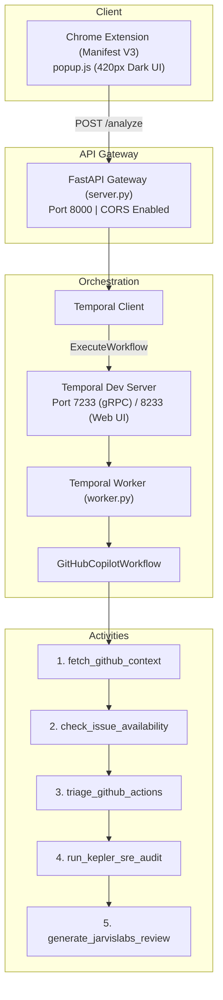

# 🚀 First PR & Repo Copilot

> **Chrome Browser Extension & AI SRE Copilot for GitHub Contributors, DevOps Engineers, and Maintainers.**  
> Powered by **Jarvislabs Token Factory**, **Temporal**, **Kepler by RubixKube**, and **`github-actions-ai-agent`**.

[](LICENSE)
[](https://www.python.org/)
[](https://temporal.io)
[](https://jarvislabs.net)
[](https://rubixkube.com)

---

## 📌 Problem & Executive Directive

Hacktoberfest and open-source ecosystems bring thousands of first-time contributors to GitHub, but most drop out before opening their first pull request:
1. **Ghost / Claimed Issues:** Beginners spend days working on issues that were already claimed in obscure comment threads.
2. **Context Overload:** Repositories have hundreds of files; new contributors do not know the exact 2–3 files to touch.
3. **Broken CI Frustration:** When `main` branch tests are failing due to upstream regressions, beginners assume their setup is broken.

**First PR & Repo Copilot** solves this inside your browser with a 1-click scan:
- 🟢 **Traffic Light Availability Engine:** Deterministic plain-code check detecting if an issue is truly open (`GREEN`), claimed in comments (`AMBER`), or assigned/closed (`RED`).
- 🛡️ **Kepler by RubixKube SRE Audit:** Analyzes repository topology (`Dockerfile`, CI/CD, Helm/K8s, tests, lockfiles) and calculates an operational readiness score.
- ⚡ **Dynamic CI/CD Triage (`github-actions-ai-agent`):** Diagnoses recent GitHub Actions runs, extracting root causes of failing steps and shielding LLM prompts with secret redaction.
- 🧠 **Jarvislabs Token Factory LLM:** Pinpoints exact files to edit, extracts setup commands, formulates an action plan, and drafts a polite *"Can I be assigned?"* comment.
- 🔄 **Temporal Orchestration:** Fault-tolerant 5-activity workflow that survives worker crashes mid-flight.

---

## 🏗️ System Architecture



---

## 🛠️ Project Structure

```text
mauji/
├── README.md               # Project documentation & pitch guide
├── context.md              # Team & AI assistant single source of truth
├── requirements.txt        # Backend dependencies
├── .gitignore              # Git ignore rules
├── backend/
│   ├── server.py           # FastAPI REST API exposing POST /analyze
│   └── worker.py           # Temporal Workflow + 5 Activities (GitHub, Kepler, Jarvislabs)
└── extension/
    ├── manifest.json       # Chrome Extension Manifest V3
    ├── popup.html          # Dark-mode GitHub-styled popup UI
    └── popup.js            # Frontend logic and API integration
```

---

## 🚦 Quickstart Setup Guide

### 1. Prerequisites
- Python 3.10+
- Git
- Google Chrome
- [Temporal CLI](https://docs.temporal.io/cli) installed

### 2. Environment Variables
Create a `.env` file or export the following in your terminal:
```bash
# GitHub Token (prevents rate-limiting on recursive tree queries)
export GITHUB_TOKEN="ghp_your_token_here"

# Jarvislabs Token Factory API Key
export JARVISLABS_API_KEY="jl_your_key_here"

# Optional Model Override
export JARVISLABS_MODEL="deepseek-ai/DeepSeek-V4.1-Flash"
```

### 3. Install Dependencies
```bash
pip install -r requirements.txt
```

### 4. Start Temporal Server
```bash
temporal server start-dev
```
*Open Web UI at: [http://localhost:8233](http://localhost:8233)*

### 5. Start Backend Services
In Terminal 1 (Temporal Worker):
```bash
python backend/worker.py
```

In Terminal 2 (FastAPI Server):
```bash
python backend/server.py
```
*API health check: [http://localhost:8000/health](http://localhost:8000/health)*

### 6. Load Chrome Extension
1. Open Google Chrome and navigate to `chrome://extensions/`.
2. Toggle on **Developer mode** (top right).
3. Click **Load unpacked** and select the `extension/` directory.
4. Pin **First PR & Repo Copilot** and scan any GitHub repository or issue!

---

## 🎭 Reviewer Personas
The extension popup features a persona selector tailored for different workflows:
- **First-Time Contributor (`first_pr`)**: Highlights the exact 2–4 files to touch, quickstart commands, and drafts a polite assignment comment.
- **SRE / DevOps Audit (`sre_ops`)**: Evaluates `Dockerfile` hygiene, CI/CD pipeline coverage, Kubernetes/Helm manifests, lockfiles, and blast radius.
- **Maintainer / Auditor (`maintainer_audit`)**: Focuses on directory modularity, onboarding friction, documentation gaps, and test coverage.

---

## 🛡️ Sponsor Integrations Summary

1. **Jarvislabs Token Factory**: Hosted open LLM endpoint (`https://models.jarvislabs.net/v1`) consuming repository topology, Traffic-Light status, and Kepler signals to generate structured reviews.
2. **Temporal**: Orchestrates the multi-activity analysis pipeline with deterministic event history, retries, and worker crash recovery.
3. **Kepler by RubixKube**: AI SRE operational subagent evaluating repository infrastructure readiness and deployment risks.
4. **github-actions-ai-agent (by Shubham Londhe)**: Live CI/CD workflow run triage and security sanitization with secret redaction and untrusted prompt wrappers.

---

## 🏆 Live Judging Pitch Script (60 Seconds)

> "Hacktoberfest brings thousands of first-time contributors to GitHub, but most give up before their first pull request. Issues are written for insiders, and half the 'good first issues' are already quietly claimed in the comments.
>
> We built **First PR & Repo Copilot**—a Chrome Extension powered by **Jarvislabs Token Factory**, **Temporal**, **Kepler by RubixKube**, and **`github-actions-ai-agent`**.
>
> Open any GitHub repo or issue, pick your role—First-Time Contributor, SRE, or Maintainer—and click Scan. First, plain-code rules run a **Traffic Light check** to tell you in one second if the issue is truly open or already claimed. Second, our **Kepler SRE & Actions triage layer** audits the file tree and recent CI runs for operational readiness. Third, **Jarvislabs Token Factory** scores the codebase out of 100, pinpoints the exact files to edit, and writes a beginner-friendly PR plan and assignment comment.
>
> Best of all, every step runs as a **Temporal workflow**—if I kill our worker process mid-scan right now [kill worker], Temporal preserves the GitHub and Kepler state and resumes automatically the second the worker restarts [restart worker]."
